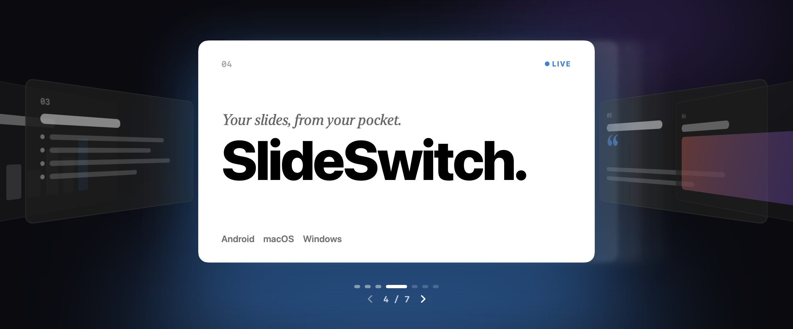

<p align="center">
  
</p>

<p align="center">
  <b>Turn your Android phone into a presentation remote for Keynote, PowerPoint and Google Slides on macOS and Windows.</b>
</p>

<p align="center">
  <a href="https://github.com/HarshaXR/SlideSwitch/releases/latest/download/SlideSwitch-android.apk">Android APK</a> ·
  <a href="https://github.com/HarshaXR/SlideSwitch/releases/latest/download/SlideSwitch-mac.zip">macOS</a> ·
  <a href="https://github.com/HarshaXR/SlideSwitch/releases/latest/download/SlideSwitch-windows-x64.zip">Windows</a> ·
  <a href="site/">Website</a>
</p>

---

## What it is

SlideSwitch is three apps that work together over your Wi-Fi:

| | App | Built with | Look |
|---|---|---|---|
| 📱 | **Android remote** (`android/`) | Kotlin, Jetpack Compose (Foundation only) | Apple-style: big rounded buttons, bold titles, gradient icons, Inter font, light/dark |
| 💻 | **Mac companion** (`mac/`) | Swift, SwiftUI, Network.framework, CGEvent | Liquid Glass throughout, System/Light/Dark |
| 🖥️ | **Windows companion** (`windows/`) | C#, WinUI 3 / Windows App SDK, SendInput | Fluent: Mica, Acrylic, Fluent motion, System/Light/Dark |

The companion runs on the computer that's presenting. The phone pairs with it once, then its
buttons become key presses in whatever app is in front: **Next**, **Previous**, **Start**,
**End** and **Black screen**.

## How it works

1. The companion starts a WebSocket server on port **48620** and advertises
   `_slideswitch._tcp` over Bonjour/mDNS. It shows a 6-digit **pairing code** and a **QR code**.
2. The phone finds the computer automatically, or you scan the QR with the camera (it opens
   `slideswitch://pair?...`), or type the IP address and code.
3. The companion returns a token, so the phone reconnects without the code next time.
4. Buttons become keys: → / ← for next and previous, Esc to end, B for black, and the right
   "start slideshow" shortcut for Keynote, PowerPoint or Google Slides.

With phones connected, the companion lists them. **Pair another device** brings the pairing
card back. The protocol is documented in [shared/PROTOCOL.md](shared/PROTOCOL.md). It's
JSON over WebSocket and built to be extended: new features add new `action`s and `type`s, and
older apps ignore what they don't know.

## Install

Grab the latest builds from **[Releases](https://github.com/HarshaXR/SlideSwitch/releases/latest)**:

- **Android** (`SlideSwitch-android.apk`): Android 8 or later. Allow installs from your browser when asked.
- **macOS** (`SlideSwitch-mac.zip`): macOS 26 Tahoe or later, Apple silicon and Intel.
  The app isn't notarized yet, so the first time right-click it and choose **Open**.
  Then allow it under **System Settings › Privacy & Security › Accessibility** (on macOS 27
  that list is called **Device Control and Data Access**) so it can press keys.
- **Windows** (`SlideSwitch-windows-x64.zip`): Windows 10 1809 or later. Unzip, run
  `SlideSwitch.exe`, and allow it through Windows Defender Firewall on **private** networks.
  SmartScreen may warn once because the app isn't code-signed yet.

## Build from source

### macOS (`mac/`)

Needs Xcode 26+ (built with Xcode 27.2). The deployment target is macOS 26.0, the first release with Liquid Glass.

```bash
cd mac && xcodebuild -project SlideSwitch.xcodeproj -scheme SlideSwitch -configuration Debug -derivedDataPath build/DerivedData build
```

```bash
open mac/build/DerivedData/Build/Products/Debug/SlideSwitch.app
```

If `xcodebuild` complains about the Command Line Tools, prefix it with
`DEVELOPER_DIR=/Applications/Xcode.app/Contents/Developer`. Debug builds are ad-hoc signed,
so each rebuild invalidates the Accessibility grant while the switch still looks on. Remove
SlideSwitch from the list with **−** and allow it again. Setting a signing team in Xcode
avoids this.

### Android (`android/`)

Open the folder in Android Studio, or use JDK 21+ and Android SDK 37:

```bash
cd android && ./gradlew :app:assembleDebug
```

```bash
cd android && ./gradlew :app:recordPaparazziDebug
```

The second command renders screenshots of the main screens into `app/src/test/snapshots/images/`.
The app uses AGP 9.5, Kotlin 2.4 and Compose BOM 2026.09. The font is **Inter**, under the SIL
Open Font License ([license](android/third_party/inter/LICENSE.txt)), because SF Pro may only
be used on Apple platforms.

### Windows (`windows/`)

Needs Windows 10 1809+, the .NET 8 SDK, and Visual Studio 2022 with the WinUI workload. Open
`windows/SlideSwitch.sln` and press F5, or:

```powershell
msbuild windows/SlideSwitch/SlideSwitch.csproj /restore /t:Publish /p:Configuration=Release /p:Platform=x64 /p:RuntimeIdentifier=win-x64 /p:SelfContained=true
```

GitHub Actions ([`.github/workflows/windows.yml`](.github/workflows/windows.yml)) builds it on
every push and attaches the zip to each tagged release.

## Website

[`site/`](site/) is a static, dependency-free landing page (HTML, CSS and a little JS) with
direct download buttons. It highlights the download for the visitor's platform, and respects
reduced-motion, reduced-transparency and higher-contrast settings. Host it on GitHub Pages,
Vercel or anything static.

## Repository layout

```
android/    Android remote (Compose)
mac/        macOS companion (SwiftUI + Liquid Glass)
windows/    Windows companion (WinUI 3)
shared/     PROTOCOL.md: the protocol all three speak
site/       Landing page with download links
docs/       README assets
```

## Notes and defaults

- Local network only, no TLS in v1. The pairing code, plus a 5-second lockout after 3 wrong
  codes, limits who can connect.
- Start-presentation keys: Keynote ⌥⌘P, PowerPoint for Mac ⇧⌘↩, other Mac apps ⌘↩ (Google
  Slides). On Windows: F5, or Ctrl+F5 when a browser is in front.
- Keys go to the frontmost app, so keep the presentation in front.

---

<p align="center">Made with ❤️ by Harsha · View more of my work at <a href="https://harshach.vercel.app">HA.CH</a></p>
